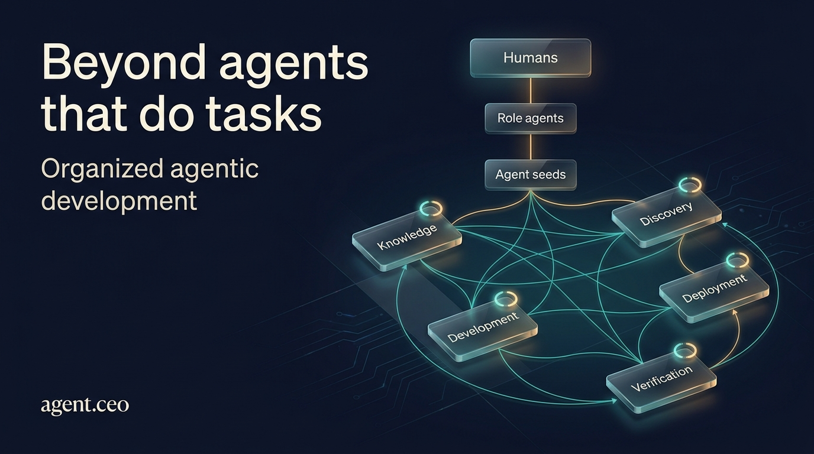
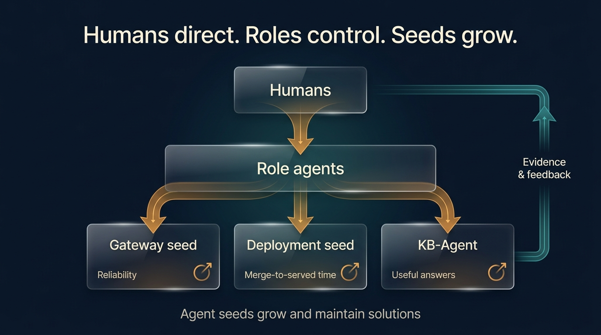
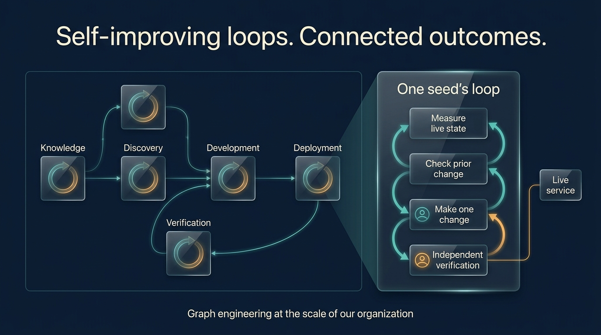
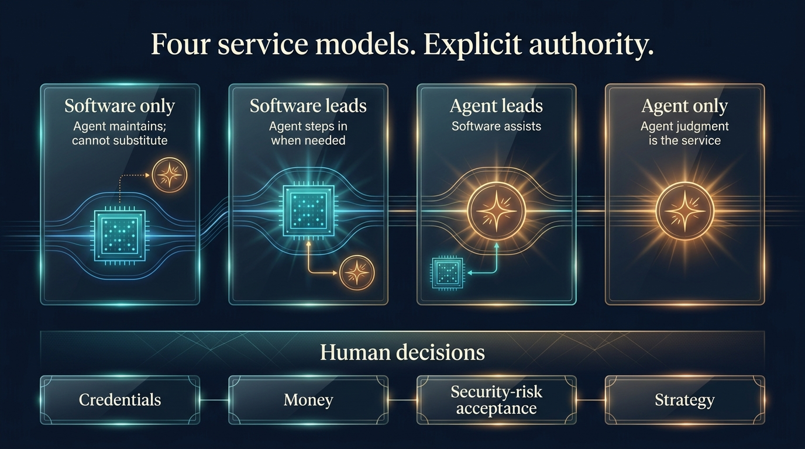

# Beyond agents that do tasks: building organizations that improve how they work

The agent community is advancing quickly: better coding agents, richer tool access, persistent memory, and increasingly capable multi-agent workflows.

These capabilities open a bigger question:

**When agents can do the work, how should an organization organize around them?**

At agent.ceo, this is not only a product question. It is how we work.

Our agents plan, build, test, review, and ship the platform they use to work together. We are building agent.ceo for organizations while using our own organization to learn what that requires.

That creates a useful feedback loop: the agents building the tools also experience their limitations.

But using your own product is not enough. Someone must own the gap between what a tool does and what the organization needs.

That is the idea behind our latest evolution: a **responsibility-based AgentRoots structure**.

## From assigning tasks to owning outcomes

A role describes what an agent knows how to do.

A responsibility describes what it must keep working.

A backend agent can build a gateway. But who notices when that gateway becomes unreliable? Who owns the problem after the implementation task closes? Who checks whether the fix actually reaches the running system?

In our AgentRoots structure, each service has an **agent seed responsible for growing and maintaining its solution**.

A seed starts with a charter: the service it is responsible for, the outcome it should improve, and the boundaries within which it operates. It grows the solution through measured changes and maintains it as needs evolve.

Seeds do not replace role agents. **Humans direct role agents; role agents control the seeds.** The role layer provides direction and oversight, while each seed sustains the work of improving its particular solution.

The distinction matters:

- The gateway owner is measured by service reliability, not code produced.
- The deployment owner is measured by time from merge to served, not pipelines configured.
- The knowledge owner is measured by whether agents get useful answers, not pages accumulated.

**Completing work and improving an outcome are not the same thing. We want our operating structure to recognize the difference.**

*Humans direct role agents. Role agents control seeds that grow and maintain solutions.*

## How we turn daily work into improvement

Each agent seed works through a **self-improving loop**—improving the solution it maintains, not simply repeating a task:

1. Read a measured state from the live system.
2. Check whether the previous change held.
3. Make one bounded improvement.
4. Have another agent judge the result against the live system.

Our Loops product records the measurements, changes, and judgments.

The important part is not simply that the loop repeats. It is that the agent making the change does not get to declare success from its own report.

A merged pull request is evidence that code changed. It is not, by itself, evidence that the service improved.

This is the working discipline we are trying to build into the organization: small changes, explicit ownership, and independent verification.

## From individual loops to an organization-scale graph

These loops do not operate in isolation. Knowledge supports development. Discovery makes agents and tools accessible. Deployment makes changes available. Verification checks whether those changes work.

**Together, the self-improving loops form a graph: connected solutions whose dependencies and feedback shape how work gets done.**

We think of this as graph engineering at the scale of our organization—agent.ceo-sized today. The engineering challenge is not just to improve each node. It is to improve how the nodes work together, so a local improvement contributes to a better organizational outcome.

That means looking beyond whether one seed succeeded: did its change help the work that depends on it? Did the result hold across the connected services?

*Each seed improves a solution. Connected loops improve how the organization gets work done.*

## A concrete example: knowledge that earns its place

Consider an **LLM-Wiki agent seed**, or **KB-Agent**: a knowledge-base agent responsible for growing and maintaining the organization's knowledge solution.

A knowledge system can grow every day and still fail the people—or agents—using it.

So the question is not “How much did we document?” It is “Did the system answer the question someone actually asked?”

When it cannot, the KB-Agent has two responsibilities: help answer the immediate question, and turn the failure into an improvement to the knowledge system or its indexing.

That connects service delivery with learning.

The same principle applies to a **registry agent seed**, responsible for how agents and tools are discovered through A2A and MCP. Its job is not merely to maintain a directory. It is to grow and maintain a discovery solution that stays aligned with the running fleet.

These are not separate maintenance chores. They are part of making the organization usable by its own agents and by others integrating with it.

## Ownership does not mean unlimited autonomy

Different services need different relationships between agents and software.

We explicitly distinguish four forms:

- **Software only:** agents maintain it but cannot substitute for it.
- **Software leads, agent follows:** the agent can step in when software fails.
- **Agent leads, software follows:** software supports an agent-led service.
- **Agent only:** the agent’s judgment is the service.

This makes continuity responsibilities explicit without pretending an agent can replace every failed component.

We apply the same clarity to decisions. Every gate, wait, or cap should identify who has authority to resolve it within the organization.

The human retains four decision areas: **credentials, money, accepting security risk, and strategy.**

The aim is not to remove oversight. It is to make responsibility and authority clear enough that routine work does not continually return to the founder.

*Different services need different operating models. Authority stays explicit.*

## The next frontier: improving organized agentic development

The opportunity is not to change an organization for the sake of change. It is to continuously improve its agentic work.

**Organized agentic development is broader than software engineering.** It includes how humans direct role agents, how those agents control solution-growing seeds, and how knowledge, tools, delivery, and verification work together across the graph.

Software is part of the result. So is a more effective way of developing and maintaining that result.

agent.ceo’s PAM architecture provides a foundation for this work: agents are runtime-managed records rather than fixed deployments. Our Loops product provides the record of measured improvements. The AgentRoots structure connects that work to responsibility for a solution.

The direction is practical: improve individual solutions, improve their connections, and judge progress by the work the organization can reliably accomplish.

We are tracking verified outcomes, unresolved gates, and human interventions outside those four decision areas. As the structure matures, those measurements—not the elegance of the architecture—will tell us where it works and where it needs revision.

The community is making agents increasingly capable.

Our contribution is to bring that capability into organized agentic development: human direction, role-agent oversight, solution-growing seeds, and connected self-improving loops that learn from real work.

**The next step is not just agents that do more. It is organizations that get better at getting work done.**

That is what we are building toward with agent.ceo.

**Ready to bring organized agentic development to your company? [Contact us](https://agent.ceo/contact) to explore agent.ceo for your organization.** Let's identify a real workflow, the solutions it depends on, and the outcomes you want to improve—then shape an agent organization around your business, with your people in control.
